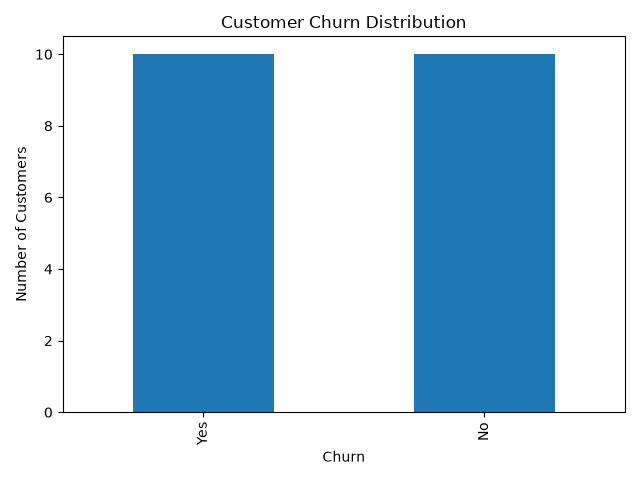

# Customer Churn Prediction

A machine learning project developed using Python to predict whether a customer is likely to leave a service.

## Project Overview

This project analyzes customer information and uses a Random Forest classification model to predict customer churn.

## Features

- Customer data analysis
- Data preprocessing
- Train/test data splitting
- Random Forest classification
- Customer churn prediction
- Model accuracy evaluation
- Churn distribution visualization

## Technologies Used

- Python
- Pandas
- Scikit-learn
- Matplotlib

## Dataset

The dataset contains customer information including:

- Age
- Monthly Charges
- Contract Months
- Support Calls
- Churn Status

## Model

The project uses a Random Forest Classifier to predict whether a customer is likely to churn.

## Visualization

## Author

Raghad Abdulrahman  
Computer Science Student